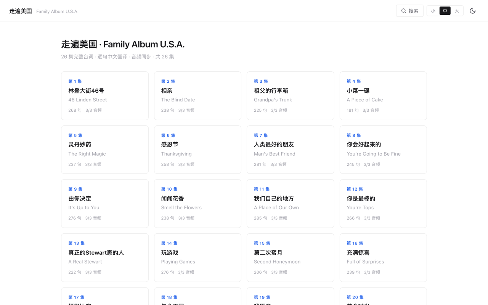
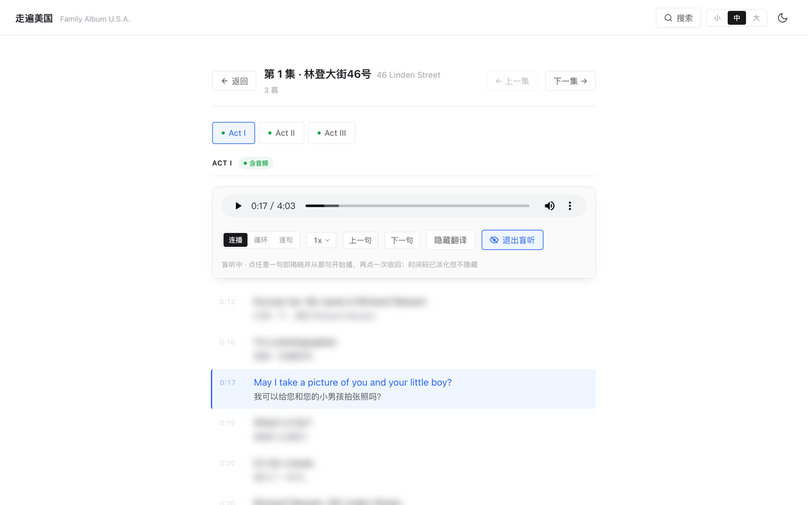
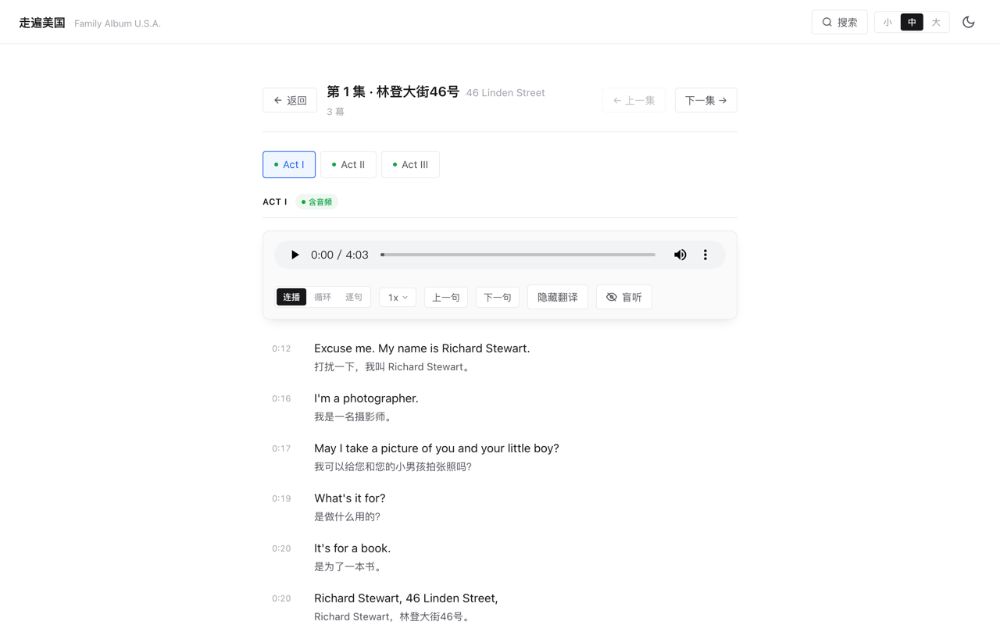

<div align="center">

# 走遍美国 · 学习版

**把一部 80 年代的情景剧，拆成 6319 句可以反复卡住的听力素材。**

26 集完整对白 · 逐句中文翻译 · 盲听模式 · 单句循环 · 纯静态零后端

**[打开网页版 →](https://shaozhengmao.github.io/family-album-usa-studied/)**



| 26 集 | 78 幕 | 6,319 句 | 78 段音频 | 纯静态 |
|:--:|:--:|:--:|:--:|:--:|
| 覆盖全剧 | 每集 3 幕 | 全部带中文翻译 | 共 411 MB | 零后端，可直接托管 |

</div>

---

## 这是什么

市面上的英语听力材料大多停在「整段音频 + 一页文稿」，中间那层——**我想只听这一句，再听一遍，然后不看字幕试试**——没人做。

这个项目就是补这一层。它把《走遍美国》全部 26 集切成 6319 句，每句都有精确的起止时间、英文原文和中文翻译，然后在浏览器里给出三种播放粒度。没有登录、没有后端、没有 App，打开网页就能用。

写它的直接原因很简单：我想在通勤路上练听力，手上只有一个手机和一副耳机。

---

## 两个核心功能

### 盲听：先听，再看

点「盲听」，全部台词变成一团模糊。想确认自己听对了，点那一句——它同时做两件事：揭晓这句的文字，并从这句开始播。



几个刻意的设计：

- 用 `filter: blur()` 而不是 `display: none`。版面不会塌，也不会出卖句子的长度——长句模糊后还是长句，短句还是短句，这本来就是听觉上能感知的信息。
- 时间码只淡化成浅灰，不隐藏。它不泄露内容，但能告诉你「这一句有 3 秒」。
- 再点一次把遮罩收回去。想一次看全幕，直接退出盲听。

### 三种播放粒度：一个按钮切换

| 粒度 | 播完这一句之后 | 什么时候用 |
|---|---|---|
| **连播** | 继续往下放，当前句高亮自动跟随 | 当背景音过一遍剧情 |
| **循环** | 同一句再放一遍（共 2 遍），然后自动进下一句 | 磨耳朵。全程不用碰键盘，双手可以腾出来 |
| **逐句** | 立刻暂停，并停到下一句的起点等你按播放 | 听写、跟读。一句一句卡死 |

循环模式会在播放条上显示 `1/2` 的进度，让你知道这一句还剩几遍。



---

## 还有什么

**学习相关**

- **句级定位**——点台词任意一句，从那句开头播（会往前提 0.12 秒，避免吃掉首辅音）
- **幕与集切换**——顶部直接切 Act I/II/III 或上一集/下一集，不用退回列表
- **速度四档**——0.75× / 1× / 1.25× / 1.5×，收在一个下拉里不占版面
- **全局搜索**——跨 26 集搜英文、中文或集名，`Ctrl/Cmd + K` 唤起，结果带命中高亮
- **翻译开关**——中英对照随时收起，只看英文
- **对齐质量提示**——某幕音轨和台词表对不上时，会显示一条黄色提示，坦白告诉你「这幕单句定位可能不准」

**使用体验**

- **记住你的状态**——主题、字号、盲听开关、播放粒度都存在 localStorage，下次打开还是上次的样子
- **深色模式**——夜间练听力不刺眼
- **字号三档**——小 / 中 / 大，按屏幕和视力调
- **吸顶播放条**——滚到任何位置，控件都在手边
- **键盘优先**——空格、`←` `→`、`R` 重听、`B` 盲听，全程不碰鼠标

---

## 时间戳：这个项目最花功夫的地方

原始数据里，每句台词只有一个时间点，而且和 mp3 对不上。查下来不是小偏差：

| 问题 | 规模 |
|---|---|
| 整幕时间戳全为 0（ep18 Act II/III、ep19 全三幕） | 198 句 |
| 时间戳超出音频长度（物理上播不到） | 124 句 |
| 有明显问题的幕 | 26 / 78 |

根因是拼接了两个不同版本的音轨：ep1–15 用了裁掉静默的版本（每集约 12.6 分钟），ep16–26 用完整原声（每集约 23.5 分钟），而时间戳统一来自精简版时间轴。误差随进度累积，**加个固定偏移量修不好**。

所以用 `faster-whisper` 把 78 幕全部重新转写，再拿词级时间戳和台词表做强制对齐：

```bash
pip install faster-whisper

# 1. 转写 + 逐句对齐，产出 align_out/*.json
HF_ENDPOINT=https://hf-mirror.com python tools/align_timestamps.py --model small

# 2. 合并进 episodes.json（先试运行，看报告没问题再加 --write）
python tools/merge_alignment.py
python tools/merge_alignment.py --write
```

结果：

| 指标 | 数值 |
|---|---|
| 覆盖 | 78 / 78 幕，6319 / 6319 句 |
| 完整性 | 0 缺失、0 重叠、0 越界 |
| 平均命中率 | 0.914（中位 0.94） |
| 命中率 ≥ 0.90 的幕 | 60 / 78 |

### 三条踩出来的经验

**一、`initial_prompt` 不能传。** 把台词原文作为 prompt 喂给 whisper，它会把 prompt 当成「已经转录过的前文」直接跳过，导致每幕开头几句匹配率归零。这个坑很隐蔽——不看逐句报告的话，整体命中率看起来还挺正常。

**二、命中 0 的句子，宁可用插值也不用旧值。** 旧时间戳整体偏移 20 秒以上，留着它只会更糟；插值至少被前后两个已定位句夹住，误差不会超过一个语段。

**三、`python3 -m http.server` 会让单句定位失效。** 它不响应 HTTP Range，浏览器把音频的 `seekable` 判定成 `[0, 0]`，于是给 `currentTime` 赋值会被静默丢弃。表现是：能播放，但循环、逐句、点句子跳转全部失灵，而且控制台一个报错都没有。本地预览必须用 `tools/dev_server.py`（补了 206 响应）。GitHub Pages 原生支持 Range，线上没这个问题。

### 剩下 6 幕为什么还是不准

ep4 Act II（0.76）、ep18 Act II（0.73）、ep18 Act III（0.50）、ep19 三幕（0.74 / 0.72 / 0.53）。这几幕的音轨里混进了上一个视频的结尾和剧情解说旁白，和台词表根本不是同一个版本——文字对不上文字，任何对齐算法都无能为力。**根治只能换音频源**，所以先让前端把话说清楚：这几幕会出现黄条提示，连播不受影响。

---

## 部署

纯静态页面，GitHub Pages 直接托管，零成本。仓库自带 `.github/workflows/deploy.yml`，推 `main` 就自动构建发布。

想自己托管一份：Fork 本仓库 → **Settings** → **Pages** → **Source** 选 **GitHub Actions** → 推一次 `main`，等 Actions 跑完即可访问 `https://<你的用户名>.github.io/family-album-usa-studied/`。

---

## 键盘快捷键

| 快捷键 | 功能 |
|---|---|
| `空格` | 播放 / 暂停 |
| `←` / `→` | 上一句 / 下一句 |
| `R` | 重听当前句 |
| `B` | 开关盲听 |
| `Ctrl / Cmd + K` | 打开 / 关闭搜索 |
| `Esc` | 关闭搜索、速度菜单或弹窗 |

---

## 手机端

| 首页 | 播放页 |
|---|---|
|  |  |

底部四项导航（首页 / 搜索 / 主题 / 翻译），播放条压到两行。非盲听时上下句箭头会自动隐藏——点句子就能跳，不必占位置；进入盲听后箭头重新出现，因为这时点句子会揭晓文字，箭头是唯一不泄底的跳句方式。

---

## 项目结构

```
family-album-usa-studied/
├── index.html               # 单文件应用，无构建、无依赖
├── episodes.json            # 全部剧集数据（含句级时间戳）
├── audio-acts/              # 78 个 mp3，每幕一个
│   ├── e01_a1.mp3
│   └── ...                  # e01~e26，每集 3 幕
├── tools/
│   ├── align_timestamps.py  # whisper 转写 + 与台词表强制对齐
│   ├── merge_alignment.py   # 对齐结果合并进 episodes.json
│   └── dev_server.py        # 支持 Range 的本地静态服务器
├── docs/                    # README 截图
├── .github/workflows/       # 推送 main 自动部署
└── .nojekyll                # 关闭 GitHub Pages 的 Jekyll 处理
```

### 数据格式

```json
{
  "episodes": [{
    "id": 1,
    "title": "46 Linden Street",
    "titleCn": "林登大街46号",
    "acts": [{
      "label": "Act I",
      "audio": "audio-acts/e01_a1.mp3",
      "alignQuality": 0.93,
      "lines": [{
        "start": 12.80,
        "end": 16.00,
        "t": 34.18,
        "en": "Excuse me. My name is Richard Stewart.",
        "cn": "打扰一下，我叫 Richard Stewart。"
      }]
    }]
  }]
}
```

- `start` / `end`——对齐后的句级区间（秒，相对本幕音频），**实际使用这个**
- `alignQuality`——本幕平均命中率，低于 0.8 时前端显示黄条
- `t`——原始时间戳，只作历史参考。它与实际音频严重不符，仅在某句缺 `start` 时兜底

---

## 版权与免责

《走遍美国》（Family Album U.S.A.）的音视频、英文原稿及其中文译本的版权归原权利人所有。本项目仅用于英语学习交流，不用于任何商业用途，也不对上述内容主张任何权利。

若权利人认为本项目的展示方式侵犯了相关权益，请通过 Issues 联系，我会立即删除相关内容。
